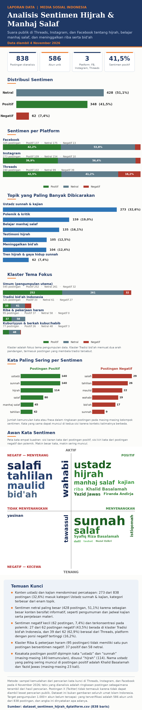
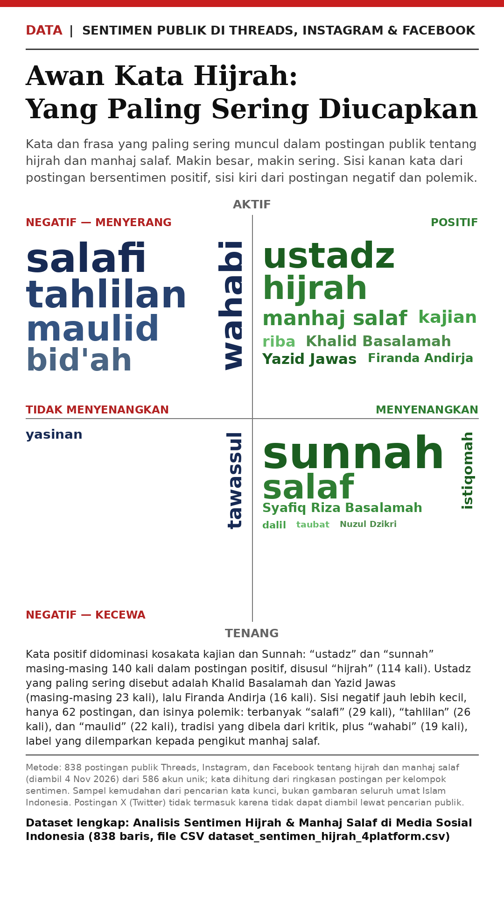

# Analisis Sentimen Hijrah & Manhaj Salaf di Media Sosial Indonesia

Analisis sentimen atas 838 postingan publik di **Threads, Instagram, dan Facebook** tentang testimoni hijrah, belajar manhaj salaf dari ustadz sunnah dan salafi, tren hijrah di Indonesia, serta meninggalkan riba, pekerjaan haram, tradisi kuburiyyun, dan tradisi bid'ah menuju Islam yang kaffah sesuai Sunnah dan pemahaman salaful ummah.





## Temuan Kunci

- **838 postingan dari 586 akun unik** dianalisis. Sentimen terhadap hijrah dan manhaj salaf: Netral 428 (51,1%), Positif 348 (41,5%), Negatif 62 (7,4%).
- **Konten ustadz dan kajian mendominasi percakapan**: 273 postingan (32,6%) masuk kategori Ustadz sunnah & kajian. Nama yang paling sering muncul di postingan positif adalah Ustadz Khalid Basalamah dan Ustadz Yazid bin Abdul Qadir Jawas (masing-masing 23 kali).
- **Sentimen netral paling besar** karena sebagian besar konten bersifat informatif, seperti pengumuman jadwal kajian dan penjelasan materi.
- **Sentimen negatif kecil dan terkonsentrasi pada polemik**: 27 dari 62 postingan negatif (43,5%) berada di klaster Tradisi bid'ah Indonesia, yaitu postingan pembela tahlilan, maulid, dan yasinan. Sebanyak 39 dari 62 postingan negatif (62,9%) berasal dari Threads, platform dengan porsi negatif tertinggi (16,2%).
- **Klaster Riba & pekerjaan haram (95 postingan) tidak memiliki satu pun postingan bersentimen negatif**: 37 positif dan 58 netral.
- Kosakata postingan positif dipimpin kata "ustadz" dan "sunnah" (masing-masing 140 kemunculan), disusul "hijrah" (114). Kosakata postingan negatif dipimpin "salafi" (29), "tahlilan" (26), "maulid" (22), dan label "wahabi" (19).

## Dataset

File utama: [`data/dataset_sentimen_hijrah_4platform.csv`](data/dataset_sentimen_hijrah_4platform.csv), 838 baris, satu baris per postingan.

| Kolom | Isi |
| --- | --- |
| id | Nomor urut baris |
| platform | Threads, Instagram, atau Facebook |
| username | Akun penulis postingan |
| tanggal_utc | Tanggal postingan (UTC) |
| tipe_konten | text, image, video, atau carousel |
| likes | Jumlah suka sebagaimana terambil (boleh kosong bila sumber tidak mencantumkan) |
| komentar | Jumlah komentar sebagaimana terambil (boleh kosong) |
| teks_ringkasan | Ringkasan isi postingan sebagaimana terambil dari hasil pencarian (maks 500 karakter) |
| url | Tautan sumber postingan |
| kategori_topik | Testimoni hijrah, Belajar manhaj salaf, Ustadz sunnah & kajian, Meninggalkan bid'ah, Tren hijrah & gaya hidup sunnah, atau Polemik & kritik |
| sentimen | Sikap postingan terhadap hijrah dan manhaj salaf: Positif, Netral, atau Negatif |
| klaster_tema | Umum (pengumpulan utama), Riba & pekerjaan haram, Kuburiyyun & berkah kubur/habib, atau Tradisi bid'ah Indonesia |

File pendukung: [`data/kata_frekuensi_infografis.csv`](data/kata_frekuensi_infografis.csv) berisi hitungan kemunculan 32 kata dan frasa tema per kelompok sentimen, dasar ukuran kata pada infografis awan kata.

Distribusi per platform: Facebook 325 postingan (230 akun), Instagram 273 (165 akun), Threads 240 (191 akun).

## Metode

1. Postingan publik dikumpulkan lewat pencarian media sosial pada 4 November 2026 dengan banyak set kata kunci: testimoni hijrah, manhaj salaf, nama-nama ustadz sunnah, meninggalkan bid'ah dan riba, resign pekerjaan haram, kuburiyyun dan tawassul, ngalap berkah habib dan gus, haul, tahlilan, yasinan, selamatan, dan maulid.
2. Hasil digabung, diduplikasi dibuang berdasarkan URL, lalu disaring relevansinya satu per satu. Postingan di luar tema dibuang dan jumlahnya dicatat di dokumen ringkasan.
3. Setiap postingan diberi satu label kategori topik dan satu label sentimen berdasarkan isinya.


Dokumen metode dan statistik lengkap ada di [`docs/ringkasan_analisis.md`](docs/ringkasan_analisis.md).

## Keterbatasan

- Sampel kemudahan dari pencarian kata kunci, **bukan gambaran seluruh umat Islam Indonesia** dan bukan sampel acak.
- Teks yang dianalisis adalah ringkasan postingan sebagaimana terambil dari hasil pencarian, bukan teks asli lengkap setiap postingan.
- **Postingan X (Twitter) tidak termasuk** karena tidak dapat diambil lewat pencarian publik (X memblokir pengindeksan eksternal).
- Target pengumpulan 1.000+ akun **belum tercapai**: yang terverifikasi adalah 586 akun unik. Angka ini dinyatakan apa adanya dan dataset dapat diperluas lewat putaran pengumpulan lanjutan.
- Sebagian sel likes dan komentar kosong karena sumber hasil pencarian memang tidak mencantumkan angkanya. Tidak ada angka yang dikarang untuk mengisi kekosongan tersebut.

## Struktur Repo

```
.
├── README.md
├── LICENSE
├── data/
│   ├── dataset_sentimen_hijrah_4platform.csv
│   └── kata_frekuensi_infografis.csv
├── docs/
│   └── ringkasan_analisis.md
└── output/
    ├── infografis_lengkap_hijrah.png
    └── infografis_awan_kata_hijrah_1080x1920.png
```

## Lisensi

MIT License, lihat file [LICENSE](LICENSE). Dataset berisi ringkasan postingan publik beserta tautan sumbernya; hak atas konten asli tetap milik masing-masing penulis postingan.
